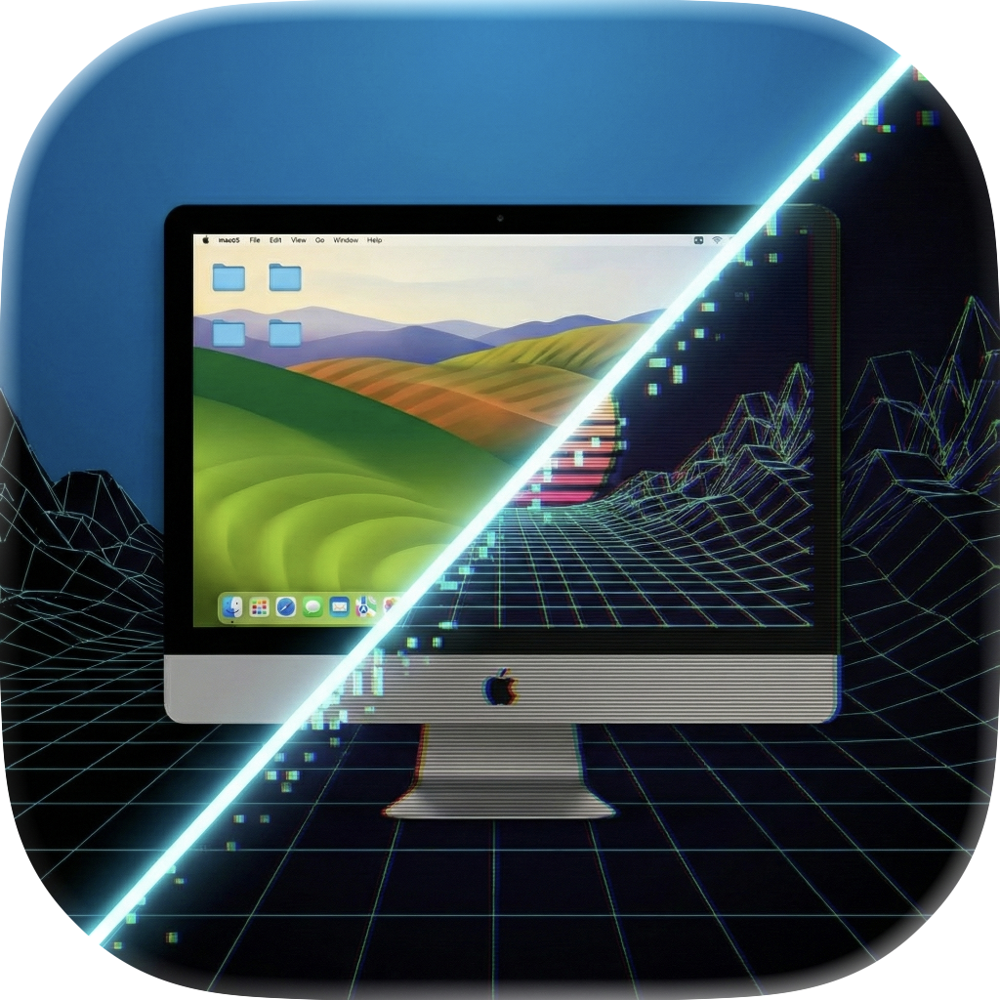
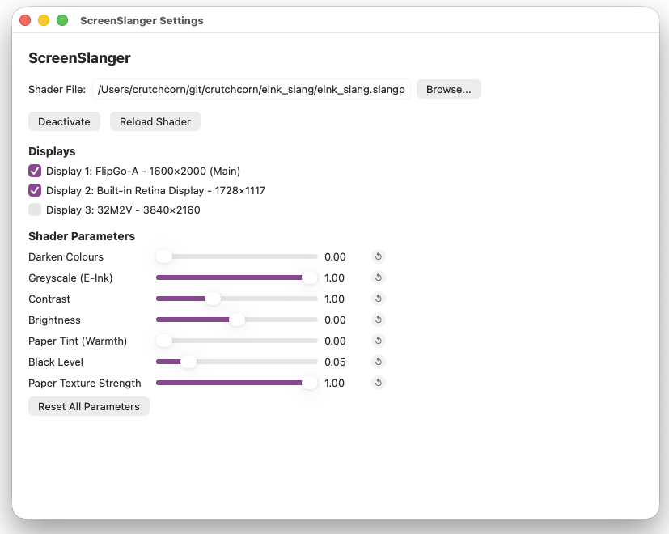

<h1>ScreenSlanger</h1>

Apply shaders to your Mac's displays.

Give your desktop an e-ink look, try a retro screen effect, or add a little animated color. ScreenSlanger applies a **shader**—a small program that changes how pixels look—to the displays you choose. That includes your apps, menu bar, and Dock.

You can use [e-ink effects](https://github.com/crutchcorn/eink_slang), [RetroArch shaders and presets](https://github.com/libretro/slang-shaders), or write your own effect starting from the [waves example](./assets/waves.slang).

## Install ScreenSlanger

The current version requires an **Apple Silicon Mac (M1 or later) running macOS 27 or later**.

An older prerelease is available on the [Releases page](https://github.com/crutchcorn/ScreenSlanger/releases). For the current features described here, follow the [build instructions](./CONTRIBUTING.md#build-and-run).

Once built, you can copy `ScreenSlanger.app` to your Applications folder and open it. The app bundles the tools it needs to run shaders, so you can also share that built app with someone who doesn't have Xcode or Homebrew installed.

## Try your first shader

Let's start with something easy to spot: the [waves shader](./assets/waves.slang) adds an animated color tint to your desktop. Save the file to your Mac, then:

1. Open ScreenSlanger. Its settings window opens with it.
2. Click **Browse...** and choose the `.slang` file. You can also choose a `.slangp` RetroArch preset.
3. Under **Displays**, select at least one monitor to filter.
4. Click **Activate** and allow screen-recording access when macOS asks.

ScreenSlanger needs that permission to capture the desktop before applying the effect. If capture doesn't start, check **System Settings → Privacy & Security → Screen & System Audio Recording**, enable ScreenSlanger, and try activating it again.

You can keep using your apps while the effect is active. Click **Deactivate** to stop it, or click the paintbrush in the menu bar to toggle it. To return to settings, choose **ScreenSlanger → Settings** or press **⌘,** while the app is active.

## Make it your own

One shader applies across all selected displays. You can leave your laptop display unchanged while filtering an external monitor, for example.

When a shader exposes adjustable parameters, they appear under **Shader Parameters**. Change the sliders to tune the effect; ScreenSlanger remembers those values for that shader. The same values apply to every selected display.

If you're editing a shader, **Reload Shader** recompiles it, including files referenced by a preset. For native Slang effects, the [waves example](./assets/waves.slang) shows the `shaderFunction(ShaderInput input)` entry point ScreenSlanger expects.

Keep a downloaded shader's folder together. Presets can depend on other shaders, images, or included files, so moving just the `.slangp` file can break the effect. The same applies when sharing shaders with someone else.

## Balance motion and power use

**Frames per second** limits how often ScreenSlanger captures and draws. It defaults to 60 and accepts values from 1 to 240, capped at each display's refresh rate. Lower values reduce the work needed to keep the effect updated.

Keep **Animate while desktop is still** enabled for effects like waves that change over time. For a static filter, turn it off: ScreenSlanger can then wait for the desktop to change before drawing again.

## Build or contribute

See [CONTRIBUTING.md](./CONTRIBUTING.md) for setup, build and test commands, and details about the bundled shader tools.

## Credits

ScreenSlanger builds on [ScreenShader](https://github.com/branpk/ScreenShader/), with shader preset implementation references from [ShaderGlass](https://github.com/mausimus/ShaderGlass).
